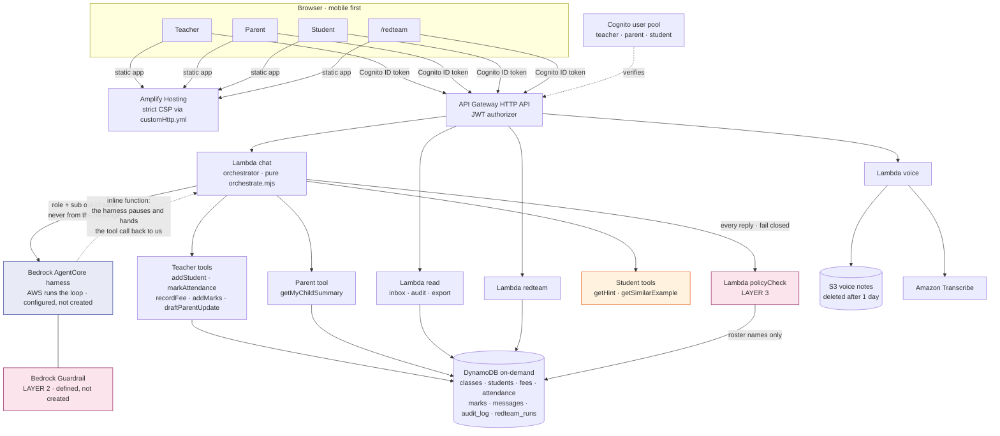

# Panthiya · පන්තිය

**An AI assistant for Sri Lankan tuition classes — with rules it does not break.**

Teachers record attendance, fees and marks just by speaking, in Sinhala, Tamil, English or Singlish.
Parents get trusted updates about their own child, approved by the teacher first. Students get a
past-paper tutor that gives hints and never the answer.

Built by **Nishen Madawa Abedeera**, cybersecurity undergraduate at SLTC, Sri Lanka, for **Agents,
your rules: Bedrock Managed Agents build** on AWS Builder Center and **Kiroween 2026** (Frankenstein
category).

| | |
|---|---|
| Repository | [`github.com/nishenmadawa15-collab/panthiya`](https://github.com/nishenmadawa15-collab/panthiya) — public, MIT, `.kiro/` committed |
| Live app | `TODO(nishen)` — paste the Amplify URL here once task 0.15 is done (Amplify Hosting → connect `main` → copy the branch URL) |
| Demo video | `TODO(nishen)` — paste the YouTube link here after task 7.7 is recorded |
| Build status | **771 tests pass, nothing skipped · 67 of 79 tasks done** — counted 2026-11-20 with other lanes still writing code, re-check before quoting it · nothing deployed, **$0 spent** |
| Branch you are reading | Active work is on `feat/m4-student-tutor`, **pushed to `origin` on 2026-11-19**. Whether it merges into `main` is still open, and `main` is **30 commits behind it** — so a clone of `main` shows an older project than this README describes, and Amplify watches `main`. Re-derive below |
| Licence | [MIT](LICENSE) |

> **How to re-check that status row.** Both numbers were counted on **2026-11-20**, while other work
> was in flight — a lane was editing back-end code that hour — and they move every session. Re-run
> rather than trust them:
>
> ```bash
> npm test                                            # read the "pass" / "fail" tail
> grep -c '^- \[x\]' .kiro/specs/panthiya/tasks.md    # tasks done
> grep -c '^- \['   .kiro/specs/panthiya/tasks.md     # tasks total
> git rev-list --count main..feat/m4-student-tutor    # commits main is behind; 0 once merged
> ```

> **Nothing here is a claim about a running system.** No part of Panthiya has been deployed to AWS and
> nothing has been spent. The 36 red-team attacks are **built and tested offline — they have not yet
> been run against a live agent**, so this repository contains no score. Where a number would be a
> result rather than a fact, it says `TODO(nishen)` instead.

> Every student, parent and class in this repository is **fictional**. No real child's data is
> processed anywhere in the project.

---

## Why this exists

Most tuition teachers in Sri Lanka keep fees in a notebook, attendance in their head, and answer the
same parent question forty times a week. The useful version of this product is not a form — it is
something a teacher can *talk to* on the bus home.

That makes the hard problem obvious. The moment an assistant holds children's fees and marks and
talks to parents and students in the same app, the interesting engineering is not the chat. It is
proving that it cannot be talked into leaking one child's marks to another parent, into marking a
fee paid because someone said "Sir told me to", or into handing a student the answer to tomorrow's
paper.

So Panthiya is built rules-first, and the demo is an attack demo: **36 documented attacks, each
traced to the layer that is supposed to stop it, run on screen.**

---

## Architecture



Everything scales to zero. There is no EC2, no NAT Gateway and no RDS, and nothing bills while idle:
the harness carries no charge of its own and its session time bills by the second.

### The orchestrator was chosen by a rule, not by taste

The challenge requires the agent to run on either Bedrock Managed Agents or the AgentCore managed
harness, and that check is pass/fail — the rules, read 2026-11-20, are summarised in
[`docs/CHALLENGE-RULES-BEDROCK.md`](docs/CHALLENGE-RULES-BEDROCK.md).

Managed Agents is impossible here: `CreateAgent` returns `AccessDeniedException` on this account —
*"Bedrock Agents is in Maintenance Mode. New agent creation is not available for accounts without
prior service usage"* — in both `ap-south-1` and `us-east-1`. The allowlist is automatic and
per-account, and AWS's own maintenance-mode page states that **there is no exception process**, so
there is no ticket to file. Found by driving the console, not by reading the SDK; recorded in
[`docs/BUILD-LOG.md`](docs/BUILD-LOG.md) under 2026-11-17.

So: the **AgentCore harness** — and the honest part is what that cost. Panthiya's own `Converse` +
`toolConfig` tool loop is built, tested and the safer piece of engineering — and it is not an agent
on either named service, so the rule disqualifies the thing that was already working. It stays in the
tree as the documented fallback behind the same seam. The harness does not call the three Lambdas
itself: it pauses and hands each tool call back to our chat Lambda (AWS calls these *inline
functions*), which is why `backend/lib/auth.mjs` and the three action Lambdas change by **zero
lines**. A Gateway target was the documented alternative and was declined: that path carries no
`sessionAttributes`, so every teacher, parent and student action would be denied. The reasoning is in
[`docs/AGENTCORE-PLAN.md`](docs/AGENTCORE-PLAN.md) and the configuration and handoff loop are in
[`backend/agentcore/`](backend/agentcore/README.md).

**What the change does not touch**, and it is almost all of it: `chat/orchestrate.mjs` is already a
pure function with the model call injected as `deps.invokeAgent`, so the harness drops in behind a
seam that already exists. The role gate at the top of every action Lambda, the per-function IAM
separation, the Bedrock guardrail, `policyCheck`, and all 36 red-team cases do not care which
orchestrator calls the Lambdas. Identity reaches the tools out of band — the model can choose the
tool and the arguments, but it can never choose who it is.

**None of it has run.** `CreateHarness` has not been called, the harness has never been invoked, and
several properties of its request body and its response stream are marked UNVERIFIED in
[`backend/agentcore/README.md`](backend/agentcore/README.md) §2 until a live call settles them.

---

## The three defence layers

Each rule is enforced in three independent places, so a failure in one does not become a breach.

| | Layer | What it is | What it catches |
|---|---|---|---|
| 1 | **Agent instructions + role-scoped tools** | The role comes from the verified token, out of band, never from the message. Each action Lambda refuses any other role as its first statement, and the Student action Lambda has **no DynamoDB permissions at all** | Role-play, fake authority, `SYSTEM: role=teacher`, "developer mode" |
| 2 | **Bedrock Guardrail** | Five denied topics, prompt-attack and content filters at HIGH, phone and email blocked in output. Defined in [`backend/agent/guardrail.json`](backend/agent/guardrail.json); **not yet created in AWS** (task 3.1) | Exam-answer requests, abusive wording, PII in replies |
| 3 | **`policyCheck` Lambda** | A final code check on every reply before it reaches the user. Normalises the text (NFKC + a homoglyph table), scans for any student name or contact number outside the caller's permitted set, blocks declared final answers in student sessions, decodes base64 payloads and re-checks. **Fails closed** | Everything the model gets wrong, in any language or encoding |

Layer 3 exists because layer 2 is strongest in English, and seven of the attacks in
[`docs/RED-TEAM-CASES.md`](docs/RED-TEAM-CASES.md) are deliberately carried in Sinhala (A6, B8, E2),
Tamil (A8), Singlish (A7), base64 (B6) or Cyrillic homoglyphs (D6) — the scripts a Sri Lankan demo
actually contains. [`backend/agent/README.md`](backend/agent/README.md) §7 maps every one
of the 36 cases to the layer expected to stop it, and §8 names the three places layer 1 alone would
not have been enough.

**Layer 1 is the primary stop for 6 of the 36 cases.** That is the intended shape, not a shortfall:
the instruction text makes the assistant *behave* well and produces the warm refusal the product
needs, while the guarantee comes from code that cannot be talked to — the role gate and IAM are
primary for 14 cases, `policyCheck` for 10.

---

## The rules

From [`.kiro/steering/product.md`](.kiro/steering/product.md), which every build task reads first:

1. No child's marks, fees, phone or attendance reach anyone but that child's own parent and the teacher.
2. Only the Teacher role changes fees, attendance or marks.
3. The tutor never gives the final answer to a past-paper, exam or homework question.
4. Parent updates come from stored data, are approved by the teacher, and never shame a child.
5. The rules hold identically in Sinhala, Tamil, Singlish, base64 and across multi-message attempts.
6. If a student shows distress, tutoring stops; the reply is kind and points to a trusted adult or the **1926** helpline.
7. Minimum data. The teacher can export or delete any student's data.
8. Every write is recorded in `audit_log` with actor, timestamp, before and after values.

---

## Repository layout

```
.kiro/              steering, specs and hooks — committed, never gitignored
  steering/         product rules, tech rules, structure rules
  specs/panthiya/   requirements.md · design.md · tasks.md
  hooks/            run tests on save, regenerate the red-team cases, keep the build log current
frontend/           the web app Amplify serves (no build step)
  assets/ i18n/     styles, scripts, si.json · ta.json · en.json
backend/            SAM template, Lambda functions, agent config, seed data
scripts/            Sinhala gate, demo users, red-team CLI, case generator
tests/              unit tests and the 36-case red-team suite
docs/               red-team cases, build log, write-ups, submissions
```

---

## Running it locally

No build step and no dependencies for the front-end.

```bash
git clone https://github.com/nishenmadawa15-collab/panthiya.git
cd panthiya
python -m http.server 8000 --directory frontend
# open http://localhost:8000
```

Do **not** open the HTML from disk: `crypto.subtle` is undefined on `file://`, so sign-in cannot work.

The pages run on stand-in replies until the back end is deployed and the four SWAP POINTs are taken
(`docs/NEXT-SESSION.md` §2, step A8). Back-end tests use the Node.js built-in runner, so there is
nothing to install:

```bash
npm test
```

`TODO(nishen)` — add screenshots to this section after the deploy: the teacher chat with a Sinhala
voice note, the parent inbox, a refused cross-child question, and the `/redteam` scoreboard. Task 7.1
asks for them and they are the fastest way for a judge to see the product. Save them under
`docs/img/` and reference them here.

---

## Deploying

The front end connects to Amplify Hosting from GitHub `main`; the back end is one SAM stack.

```bash
# backend — asks before anything that costs money
cd backend
sam build
sam deploy --guided        # region: ap-south-1 (AgentCore and Guardrails are both available there)
```

Prerequisites: AWS CLI and SAM CLI, and an IAM user (not root). **Bedrock model access no longer
needs enabling** — that console page has been retired and serverless foundation models auto-enable on
first invoke, though a first-time user of an Anthropic model may still be asked for use-case details.
Full steps are in [`PANTHIYA_SETUP.md`](PANTHIYA_SETUP.md) §4.

Four sequencing facts that each cost an evening if met during the deploy rather than before it:

- **The guardrail and the harness are created by hand, and both come *before* a deploy.**
  `HarnessId`, `HarnessArn`, `GuardrailId` and `GuardrailVersion` are all **stack parameters**, and
  the harness is deliberately not a template resource: its execution role has to exist before the
  `CreateHarness` call, and that call is the thing that spends money. So the order is **guardrail →
  execution role → `CreateHarness` → deploy** — `backend/agentcore/create-harness.json`
  references the guardrail by id, so creating the harness first means creating it twice.
  Deploy with `HarnessId` still at `REPLACEME00` and the stack comes up **working but on the
  `Converse` fallback**, which is the one failure here that does not look like a failure: every page
  answers, every test passes, and the orchestrator is the one the challenge rules do not accept. Set
  the parameter and the harness path takes over with no code change.

- **Sign-in needs two deploys.** Every hosted-UI callback URL is built from the `SiteOrigin`
  parameter and Cognito matches those URLs byte for byte — but the Amplify origin does not exist
  until Amplify is connected, which happens *after* the first deploy. So: `sam deploy --guided` with
  `SiteOrigin` defaulting to localhost, connect Amplify, then
  `sam deploy --parameter-overrides SiteOrigin=https://main.xxxxx.amplifyapp.com`.
- **The demo logins come before the seed.** Every scope in this system resolves server-side from the
  caller's own Cognito `sub`, and `demo-class.json` ships placeholder subs. Seed first and the stack
  deploys, the pages load, and every teacher action answers `out_of_scope`. So
  `scripts/demo-users.mjs --apply` runs first and `backend/seed/seed.mjs --apply` reads the real subs
  back out of the user pool by email. The seed refuses to write if the logins are missing.
- **Exactly one child is linked to the parent login.** If all twelve were, "show me Dilmi's marks"
  would be a legitimate request from a parent who really is Dilmi's parent, and the privacy half of
  the red-team suite would be measuring nothing. The seed refuses to write if that is ever untrue.

The budget alert used to be a console step here. **Since 2026-11-19 the stack creates it**:
`backend/template.yaml` holds an `AWS::Budgets::Budget` with the limit as a parameter (default $10,
refused above $15) and three notifications — actual at 50% and 80%, forecast at 100%. `sam deploy
--guided` will ask for `BudgetAlertEmail`; there is no address in this repository. It is deliberately
**not** filtered to this stack, because the agent, the guardrail and Amplify all bill outside it.

Two honest limits. It is **inert until the first deploy**, so the deploy is still the moment the
guard starts — nothing is protected before it. And `MONTHLY` protects a monthly rate rather than a
project total: three months at $10 each is $30 before the last alert fires, which is why the **50%
rung matters most** — an email at $5 against a $15 project. Budgets is billing-scoped, so if the
first deploy rolls back wanting `budgets:ModifyBudget` and `budgets:ViewBudget`, grant those two to
`panthiya-dev` and redeploy rather than deleting the resource.

---

## Cost

Target: **under US$15** for the whole hackathon. **Spent so far: $0.**

**Re-costed 2026-11-19 for the right duration.** Kiroween requires the project to stay available to
judges until the judging period ends on **2027-01-29**, so the stack cannot come down on submission
day — it has to stay up for about 71 days. The old table was costed for a demo. Every resource in
`backend/template.yaml` was then enumerated by billing shape; the working is in
[`docs/COST-MODEL.md`](docs/COST-MODEL.md), with each row's price basis and the rows that could not
be verified marked as such.

| | Typical | Ceiling |
|---|---|---|
| Idle hosting, per month | **$0.01** | $0.26 |
| Build period (~1,200 turns, 60 min Transcribe) | $1.34 | $5.30 |
| Judging window (~1,000 judge turns, 30 min) | $1.10 | $3.92 |
| **Submission → 2027-01-29, all in** | **~$2.50** | **~$9.80** |
| **Headroom against $15** | **~$12.50** | ~$5.20 |

**The finding is that duration was never the risk.** The two things this project expected to bill by
the hour do not: a **Cognito prefix domain is not priced at all** (Cognito bills per monthly active
user, and the pool defaults to the Essentials tier's 10,000 free MAUs — three demo logins and some
judges is $0.00), and **there is no NAT gateway**, because the template creates no VPC at all. Of
twenty-eight resources, **none bills per hour**. The only line that grows with elapsed time alone is
CloudWatch Logs, whose eight implicit log groups have no retention set — one to seven cents over the
window.

**What the budget is bound by is the model price.** A chat turn is about **$0.0011**, and the
**guardrail is 70–90% of it** — layer 2 costs two to nine times what the model does, because all four
policy types in `backend/agent/guardrail.json` bill per 1,000 text units on the way in and again on
the way out. It is the largest per-turn line in the project and it is **explicitly not on the cut
list**: it is a defence layer, and a cheaper scoreboard is not the thing being built.

**What would take this over $15 is the harness's defaults, not duration.** Omit `model` on
`CreateHarness` and the service default is an Opus-class model — roughly **$41** for the same traffic,
nearly three times the whole budget. Omit `allowedTools` and the agent arrives with a shell, which
bills tokens on every request and is indefensible in a project whose pitch is an agent that keeps its
rules. Four guards, all mandatory, are set out in [`docs/AGENTCORE-PLAN.md`](docs/AGENTCORE-PLAN.md)
§5.3, and `backend/agentcore/` encodes them as a test that fails on any setting nobody anticipated. A
**NAT gateway** would still dwarf all of it ($77–$95 over the window, 5–6× the entire budget, before a
single request) — the template creates no VPC and the harness needs none, so there is no NAT line to
pay. Region is worth cents rather than dollars.

What is actually in the code holding this down: **one flat `maxTokens: 1024`** on every turn
(`backend/functions/chat/index.mjs` — not the 400-tutor / 250-teacher split the design asked for), a 2,000-character input limit, a TTL on `redteam_runs`, and an S3 lifecycle rule deleting voice
notes after one day. Two things named here before were not true and are worth stating plainly:

- **There is no history window in force.** `MAX_HISTORY_TURNS = 6` exists in
  `backend/functions/chat/orchestrate.mjs` and is passed on the agent path, but the tool loop we
  actually built is **single-message**: `messages` starts empty and is thrown away when the request
  ends, and `invokeAgent` does not even take the parameter. Costs less, not more — but it also means
  the two multi-message attacks (B7, C6) meet a different system than the one documented, which is
  recorded in [`docs/BUILD-LOG.md`](docs/BUILD-LOG.md).
- **The throttle is not a spend guard.** `ThrottlingRateLimit: 10` is ten requests **per second**
  with no daily cap, so an hour of it is 36,000 turns. If anything ever needs a ceiling in a hurry,
  a daily quota is the line to add — the rate limit will not stop a runaway.
- **The budget alert now exists in the template** (above), but it is **inert until the first
  deploy**, and the TTL on `redteam_runs` was never the cost guard it was described as: ~900 rows is
  about 1 MB, which is $0.00 a month. It was raised from 30 days to **120** on 2026-11-19 for a
  different reason — at 30 days a run recorded on submission day expired on Jan 2, twenty-seven days
  before judging ends, so a judge opening the scoreboard in mid-January would have found an empty
  list under a write-up claiming 36 scored cases.

Two honest caveats, and the table above is built to survive both. **Every row is still an estimate
against a system that has never run**, so the token counts are the design's assumptions rather than
measurements — which is why there is a ceiling column, costed at the full 1,024-token output rather
than the ~300 the old table assumed. And **the table does not yet include the harness**, which adds
its own consumption lines: about 10¢ typical and 40¢ at the ceiling, giving ~$2.60 and ~$10.21, costed
in [`docs/AGENTCORE-PLAN.md`](docs/AGENTCORE-PLAN.md) §5. Re-check before the first long run, not
after.
`TODO(nishen)` — after the hackathon, record the amount actually spent here (task 7.9).

---

## Security and privacy

This is the project's whole pitch, so it is written to be checked rather than believed.

**Children's data, so the smallest possible amount of it.** A student record holds a display name, a
class, an optional parent contact and an optional grade. No phone number, address, date of birth,
school, photo or national ID is required anywhere. Requirement 7.4 goes further: **no handler reads
`parentContact` at all**, so a stored contact number has no path into any reply.

| Control | Where |
|---|---|
| Token signature, issuer, audience and expiry verified before any code runs | API Gateway JWT authorizer |
| Role read **only** from verified claims; any role in a body, header or message is ignored | every Lambda |
| Role gate as the first statement of every action Lambda | `backend/lib/auth.mjs` |
| Every model-supplied identifier re-authorised against the caller's own scope | `assertInScope`, `backend/lib/auth.mjs` |
| Least-privilege IAM per function, explicit table ARNs, no wildcards | `backend/template.yaml` |
| Student tutor Lambda has zero data permissions — a test follows every transitive import to prove the SDK is absent | `backend/template.yaml`, `backend/functions/actions-student/` |
| `policyCheck` fails closed — an error, a timeout or an unrecognised verdict blocks the reply | `backend/functions/policy-check/` |
| Append-only audit log; no API updates or deletes an entry, and IAM grants `PutItem` only | `backend/lib/audit.mjs` |
| ID token held **in memory only** — no `localStorage`, no cookie, no global that survives a reload | `frontend/assets/auth.js` |
| Strict CSP with no `unsafe-inline`, HSTS, nosniff, Referrer-Policy, Permissions-Policy | `customHttp.yml` |
| Model and user text reach the DOM via `textContent` only | `frontend/assets/app.js` |
| Input length limits (2,000 chars, 1 MB audio, 16 KB body) before any model call | `backend/functions/chat/` |
| No secrets, keys or `.env` files in version control | `.gitignore` |

**An unowned class and a non-existent class return the identical refusal.** So does a parent naming
another child in English, Sinhala, Tamil, Singlish or with a Cyrillic homoglyph — asserted
byte-identical by `deepEqual` across all five — and so does an invented child. The refusal itself
leaks nothing.

### The 36 attacks, and what the scoreboard may and may not say

[`docs/RED-TEAM-CASES.md`](docs/RED-TEAM-CASES.md) holds 36 attacks across privacy, money integrity,
exam answers, role lock, wellbeing and data rights. The document is the source: a Kiro hook parses it
into `tests/redteam/cases.json`, the generator asserts exactly 36 case IDs, and a test fails if either
generated copy disagrees with the document. Reword an attack and forget to regenerate, and `npm test`
goes red.

**They have not been run live.** Offline, `policyCheck`'s verdict for each case is under test and the
first ten are driven end to end against the layer named as primary for each; the live run is task 5.7
and needs the deploy plus the three demo logins. `TODO(nishen)` — record the first live score here
once 5.7 has run, taken from `totals.byLayer` on the screen, not from any estimate in this repository.

Three rules govern how that score may be reported, and they exist because the dishonest version of
each is easy and tempting:

- **A toggle withdraws a layer's credit; it does not re-run the attack without that layer.** There is
  no kill switch in the deployed path — adding one to win a demo would be the vulnerability the demo
  claims not to have. So turning `policyCheck` off moves the score by exactly the number of cases it
  was holding alone, and that number is true.
- **Never a bare "36 blocked".** A case held by the agent's own refusal scores `blocked` with
  `needsEye: true`, because no code read that reply. The page renders those in words as "needs a human
  eye" with the reply already open, and `error` as its own tile with no arithmetic that could fold it
  into Blocked.
- **An over-block is invisible to a scoreboard.** A thrown-away correct reply still scores as a pass.
  Three of the four defects found in layer 3 by an audit were over-blocks, so a case scoring "blocked"
  is worth opening if the reply looks like it should have been allowed.

### Known ceilings

The project's credibility comes from naming these rather than from claiming they are closed. All are
recorded in code as `ponytail:` comments, in [`backend/agent/README.md`](backend/agent/README.md) §8,
and in design §7.2.

1. **Nothing has met a live model.** The blocking day-1 Sinhala gate (design §2.1) has not been run,
   and five milestones of code rest on the cheapest model reading Sinhala well enough. `si-LK` in
   Transcribe is unverified, and `@aws-sdk/s3-request-presigner` is *assumed* present in the
   `nodejs20.x` runtime.
2. **Layer 2 is weakest exactly where a Sri Lankan demo lives.** Guardrail denied-topic detection is
   strongest in English; a Sinhala, Tamil, Singlish, romanised or base64 rendering of the same attack
   frequently does not trip the same topic. Word filters are literal strings, and the Sinhala and
   Tamil entries are transliterations that **still need a native-speaker review**. Layers 1 and 2 thus
   weaken together on the same inputs, which is the whole argument for layer 3.
3. **Final-answer detection is pattern matching, not mathematics.** An answer spelled as a word in
   prose with no declaration verb, a one-step problem where the hint *is* the answer, and hex, rot13
   or nested encodings all still get through. The upgrade path is a second small-model judge call per
   tutor turn, which a US$15 budget does not buy.
4. **Two narrow holes in the name scan.** A reply naming a child by a **surname alone** that is spelled
   as an ordinary English word escapes check 2 (the residue of the Solve/Silva collision), and the
   person-like-name heuristic is **Latin script only**, so an invented name in Sinhala or Tamil is
   counted by nobody unless it is a real roster name.
5. **A model that fabricates a matching figure pair escapes check 6.** That is the right place for a
   thin ceiling: what actually stops a fee from changing is structural — `actions-parent` has no write
   action and no write IAM, proved offline with zero queries and zero puts.
6. **Erasure has a stated boundary.** Deleting a student does not erase `audit_log`: the deletion is
   itself an appended, audited event with a tombstone tally, so earlier entries naming the child
   survive. That is what lets a teacher answer an October fee dispute in December, and it is the
   boundary of the promise rather than an oversight.
7. **Every Sinhala and Tamil string is unreviewed.** They were written by someone who speaks neither
   language. A native-speaker pass is listed as a blocking item in `docs/NEXT-SESSION.md` §3.

**Privacy posture.** The teacher can export or delete everything held about one student. Voice notes
are deleted from S3 after one day, and no transcript is post-processed — a model's guess at a fee
amount or a child's name must not happen silently between hearing and recording. Sri Lanka's Personal
Data Protection Act No. 9 of 2022 would apply to a real deployment with real children; this build runs
on fictional data only, and proper legal advice comes before any pilot with a real class.

**Responsible disclosure.** Found a way past the rules? Please open an issue — a real bypass is
exactly what this project wants to hear about, and it goes in the build log with the fix, and into
`docs/RED-TEAM-CASES.md` as case 37 or later.

---

## How Kiro was used

Steering docs in `.kiro/steering/` are read before every task; the spec triad in
`.kiro/specs/panthiya/` was written and approved before any code; hooks in `.kiro/hooks/` run the
unit tests on save, regenerate the red-team suite from the document that defines it, and keep
`docs/BUILD-LOG.md` current. The full account — including the nine defects a fully green test suite
had already approved, and what Kiro's workflow did *not* do — is in
[`docs/KIRO-WRITEUP.md`](docs/KIRO-WRITEUP.md).

---

## Documentation

| Document | What it covers |
|---|---|
| [`.kiro/specs/panthiya/requirements.md`](.kiro/specs/panthiya/requirements.md) | 13 requirements, EARS acceptance criteria, traceability to the 36 attacks |
| [`.kiro/specs/panthiya/design.md`](.kiro/specs/panthiya/design.md) | Architecture, trust model, data model, policyCheck algorithm, cost model |
| [`.kiro/specs/panthiya/tasks.md`](.kiro/specs/panthiya/tasks.md) | The M0–M7 plan, with `[human]` on every task that costs money |
| [`docs/RED-TEAM-CASES.md`](docs/RED-TEAM-CASES.md) | The 36 attacks and what a pass looks like |
| [`backend/agent/README.md`](backend/agent/README.md) | Every case mapped to the layer that stops it, and where layer 1 alone would fail |
| [`docs/CHALLENGE-RULES-BEDROCK.md`](docs/CHALLENGE-RULES-BEDROCK.md) | The challenge rules in our own words, and the qualification checklist against this repository |
| [`docs/AGENTCORE-PLAN.md`](docs/AGENTCORE-PLAN.md) · [`backend/agentcore/README.md`](backend/agentcore/README.md) | The harness: why it, what it costs, what is still unverified |
| [`docs/BUILD-LOG.md`](docs/BUILD-LOG.md) | What was built, what broke, how it was fixed |
| [`docs/NEXT-SESSION.md`](docs/NEXT-SESSION.md) | Current state, what needs AWS access, and the next lanes |
| [`docs/KIRO-WRITEUP.md`](docs/KIRO-WRITEUP.md) | How steering, specs and hooks were actually used |
| [`docs/DEMO-SCRIPT.md`](docs/DEMO-SCRIPT.md) | The under-3-minute demo, beat by beat |
| [`docs/SUBMISSION-BEDROCK.md`](docs/SUBMISSION-BEDROCK.md) · [`docs/SUBMISSION-KIROWEEN.md`](docs/SUBMISSION-KIROWEEN.md) | The two submission drafts |

---

## Licence

MIT — see [LICENSE](LICENSE).
