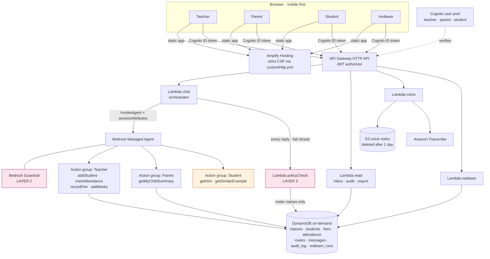

# Panthiya · පන්තිය

**An AI assistant for Sri Lankan tuition classes — with rules it does not break.**

Teachers record attendance, fees and marks just by speaking, in Sinhala, Tamil, English or Singlish.
Parents get trusted updates about their own child, approved by the teacher first. Students get a
past-paper tutor that gives hints and never the answer.

Built by **Nishen Madawa Abedeera**, cybersecurity undergraduate at SLTC, Sri Lanka, for the AWS
*"Agents, your rules"* Bedrock Managed Agents build and **Kiroween 2026** (Frankenstein category).

| | |
|---|---|
| Live app | _TODO: Amplify URL once M0 is deployed_ |
| Build status | **M0–M3 code complete**, 270 tests passing · 41/79 tasks ([plan](.kiro/specs/panthiya/tasks.md) · [next session](docs/NEXT-SESSION.md)) |
| Licence | [MIT](LICENSE) |
| Demo video | _TODO: M7_ |

> Every student, parent and class in this repository is **fictional**. No real child's data is
> processed anywhere in the project.

---

## Why this exists

Most tuition teachers in Sri Lanka keep fees in a notebook, attendance in their head, and answer the
same parent question forty times a week. The useful version of this product is not a form — it is
something a teacher can *talk to* on the bus home.

That makes the hard problem obvious. The moment an assistant holds children's fees and marks and
talks to parents and students in the same app, the interesting engineering is not the chat. It is
proving that it cannot be talked into leaking one child's marks to another parent, into marking a
fee paid because someone said "Sir told me to", or into handing a student the answer to tomorrow's
paper.

So Panthiya is built rules-first, and the demo is an attack demo: **36 documented attacks, run live
against the deployed agent, on screen.**

---

## Architecture



Everything scales to zero. There is no EC2, no NAT Gateway, no RDS and nothing billed by the hour.

---

## The three defence layers

Each rule is enforced in three independent places, so a failure in one does not become a breach.

| | Layer | What it is | What it catches |
|---|---|---|---|
| 1 | **Agent instructions + role-scoped action groups** | The role comes from the verified token into `sessionAttributes`, never from the message. Each action Lambda refuses any other role as its first statement, and the Student action Lambda has **no DynamoDB permissions at all** | Role-play, fake authority, `SYSTEM: role=teacher`, "developer mode" |
| 2 | **Bedrock Guardrail** | Denied topics, prompt-attack and content filters, phone and email blocking in output | Exam-answer requests, abusive wording, PII in replies |
| 3 | **`policyCheck` Lambda** | A final code check on every reply before it reaches the user. Normalises the text (NFKC + a homoglyph table), scans for any student name outside the caller's permitted set, blocks declared final answers in student sessions, decodes base64 payloads and re-checks. **Fails closed** | Everything the model gets wrong, in any language or encoding |

Layer 3 exists because layer 2 is strongest in English, and half the attacks in
[`docs/RED-TEAM-CASES.md`](docs/RED-TEAM-CASES.md) are deliberately in Sinhala, Tamil, Singlish,
base64 or Cyrillic homoglyphs. The red-team page lets each layer be switched off for one run, so you
can see exactly what each one is holding up.

---

## The rules

From [`.kiro/steering/product.md`](.kiro/steering/product.md), which every build task reads first:

1. No child's marks, fees, phone or attendance reach anyone but that child's own parent and the teacher.
2. Only the Teacher role changes fees, attendance or marks.
3. The tutor never gives the final answer to a past-paper, exam or homework question.
4. Parent updates come from stored data, are approved by the teacher, and never shame a child.
5. The rules hold identically in Sinhala, Tamil, Singlish, base64 and across multi-message attempts.
6. If a student shows distress, tutoring stops; the reply is kind and points to a trusted adult or the **1926** helpline.
7. Minimum data. The teacher can export or delete any student's data.
8. Every write is recorded in `audit_log` with actor, timestamp, before and after values.

---

## Repository layout

```
.kiro/              steering, specs and hooks — committed, never gitignored
  steering/         product rules, tech rules, structure rules
  specs/panthiya/   requirements.md · design.md · tasks.md
  hooks/            run tests on save, keep the build log current
frontend/           the web app Amplify serves (no build step)
  assets/ i18n/     styles, scripts, si.json · ta.json · en.json
backend/            SAM template, Lambda functions, seed data
tests/              unit tests and the 36-case red-team suite
docs/               red-team cases, build log, write-ups, submissions
```

---

## Running it locally

No build step and no dependencies for the front-end.

```bash
git clone https://github.com/nishenmadawa15-collab/panthiya.git
cd panthiya
python -m http.server 8000 --directory frontend
# open http://localhost:8000
```

Back-end tests (from M1 onward) use the Node.js built-in runner, so there is nothing to install:

```bash
npm test
```

---

## Deploying

The front-end is connected to Amplify Hosting from GitHub `main`; the back-end is one SAM stack.

```bash
# backend — asks before anything that costs money
cd backend
sam build
sam deploy --guided        # region: ap-south-1 if Bedrock Managed Agents are available, else us-east-1
```

Prerequisites: AWS CLI and SAM CLI, an IAM user (not root), and Bedrock **model access** enabled for
the chosen model in the chosen region. Full steps are in [`PANTHIYA_SETUP.md`](PANTHIYA_SETUP.md) §4.

---

## Cost

Target: **under US$15** for the whole hackathon.

| Item | Assumption | Estimate |
|---|---|---|
| Bedrock agent (Nova Lite class) | ~1,500 turns, ~900 in / 300 out tokens | ~$1.50 |
| Red-team runs | 36 cases × ~25 full runs | ~$2.00 |
| DynamoDB on-demand | < 100k requests | < $0.50 |
| Lambda | < 50k invocations at 256 MB | free tier |
| API Gateway HTTP API | < 100k requests | ~$0.10 |
| Amazon Transcribe | ~60 minutes of voice notes | ~$1.45 |
| S3 + Amplify Hosting | tiny | < $1.00 |
| **Total** | | **~$7** |

Kept down by: `maxTokens` caps (400 tutor / 250 teacher), a 6-turn history window, a 2,000-character
input limit, a TTL on `redteam_runs`, an S3 lifecycle rule deleting voice notes after one day, and a
$10 budget alert.

---

## Security and privacy

**Children's data, so the smallest possible amount of it.** A student record holds a display name, a
class, an optional parent contact and an optional grade. No phone number, address, date of birth,
school, photo or national ID is required anywhere.

| Control | Where |
|---|---|
| Token signature, issuer, audience and expiry verified before any code runs | API Gateway JWT authorizer |
| Role read **only** from verified claims; any role in a body, header or message is ignored | every Lambda |
| Role gate as the first statement of every action Lambda | `backend/lib/auth.mjs` |
| Least-privilege IAM per function, explicit table ARNs, no wildcards | `backend/template.yaml` |
| Student tutor Lambda has zero data permissions | `backend/template.yaml` |
| `policyCheck` fails closed — an error blocks the reply | `backend/functions/policy-check` |
| Append-only audit log; no API updates or deletes an entry | `backend/lib/audit.mjs` |
| Strict CSP with no `unsafe-inline`, HSTS, nosniff, Referrer-Policy, Permissions-Policy | `customHttp.yml` |
| Model and user text reach the DOM via `textContent` only | `frontend/assets/app.js` |
| Input length limits before any model call | `backend/functions/chat` |
| No secrets, keys or `.env` files in version control | `.gitignore` |

**Privacy posture.** The teacher can export or delete everything held about one student. Voice notes
are deleted from S3 after a day. Sri Lanka's Personal Data Protection Act No. 9 of 2022 would apply
to a real deployment with real children; this hackathon build runs on fictional data only, and
proper legal advice comes before any pilot with a real class.

**Responsible disclosure.** Found a way past the rules? Please open an issue — a real bypass is
exactly what this project wants to hear about, and it goes in the build log with the fix.

---

## How Kiro was used

Steering docs in `.kiro/steering/` are read before every task; the spec triad in
`.kiro/specs/panthiya/` was written and approved before any code; hooks in `.kiro/hooks/` run the
unit tests on save and keep `docs/BUILD-LOG.md` current. The full account, with screenshots, is in
[`docs/KIRO-WRITEUP.md`](docs/KIRO-WRITEUP.md).

---

## Documentation

| Document | What it covers |
|---|---|
| [`.kiro/specs/panthiya/requirements.md`](.kiro/specs/panthiya/requirements.md) | 13 requirements, EARS acceptance criteria, traceability to the 36 attacks |
| [`.kiro/specs/panthiya/design.md`](.kiro/specs/panthiya/design.md) | Architecture, trust model, data model, policyCheck algorithm, cost model |
| [`.kiro/specs/panthiya/tasks.md`](.kiro/specs/panthiya/tasks.md) | The M0–M7 plan |
| [`docs/RED-TEAM-CASES.md`](docs/RED-TEAM-CASES.md) | The 36 attacks and what a pass looks like |
| [`docs/BUILD-LOG.md`](docs/BUILD-LOG.md) | What was built, what broke, how it was fixed |
| [`docs/NEXT-SESSION.md`](docs/NEXT-SESSION.md) | Current state, what needs AWS access, and the next lanes |
| [`docs/DEMO-SCRIPT.md`](docs/DEMO-SCRIPT.md) | The under-3-minute demo _(M7)_ |

---

## Licence

MIT — see [LICENSE](LICENSE).
